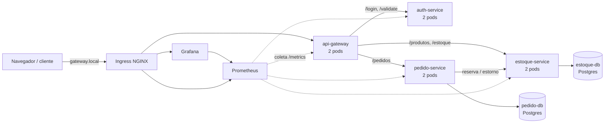

# Projeto DevOps — T3: Deploy em Kubernetes (Minikube) com CI/CD e Observabilidade

Aplicação de e-commerce em **microsserviços** (api-gateway, auth, estoque e pedido) rodando num
cluster **Kubernetes local (Minikube)**, com **2 réplicas por serviço**, configuração via
**ConfigMap/Secret**, entrada via **Ingress** e observabilidade com **Prometheus + Grafana dentro do cluster**.

> Autores: Walisson e Cauê

---

## 1. Arquitetura



- Tudo vive no namespace **`ecommerce`**.
- Dentro do cluster, os serviços se encontram pelo **nome do Service** (ex.: `http://estoque-service:8000`).
- O **api-gateway** é a entrada oficial: ele exige o token JWT (emitido pelo auth) para as rotas de pedidos e estoque.
- Cada serviço também tem seu próprio Ingress (`estoque.local`, `pedido.local`, `auth.local`) para abrir o Swagger direto.
- Os bancos têm 1 pod cada (banco de dados não se replica dessa forma) e guardam os dados num volume (PVC).

## 2. Estrutura do repositório

```
projeto-k8s/
├── api-gateway/  auth-service/  estoque-service/  pedido-service/   ← código + Dockerfile de cada serviço
├── k8s/
│   ├── 00-namespace.yaml
│   ├── gateway/    configmap · secret · deployment · service · ingress
│   ├── auth/       configmap · secret · deployment · service · ingress
│   ├── estoque/    configmap · secret · postgres · deployment · service · ingress
│   ├── pedido/     configmap · secret · postgres · deployment · service · ingress
│   └── observabilidade/
│       ├── prometheus/  rbac · configmap · deployment · service · ingress
│       └── grafana/     secret · configmap (datasource + dashboard) · deployment · service · ingress
├── k8s-extras/hpa.yaml        ← opcional: autoscaling (HPA)
├── scripts/                   ← scripts PowerShell que automatizam cada etapa
├── docs/                      ← divisão de tarefas, roteiro de apresentação, evidências
└── .github/                   ← CI (testes, build, validação dos manifests), release e Dependabot
```

## 3. Pré-requisitos

| Ferramenta | Para quê | Instalar (PowerShell como Administrador) |
|---|---|---|
| Docker Desktop | roda o Minikube | https://www.docker.com/products/docker-desktop |
| Minikube | cluster Kubernetes local | `winget install Kubernetes.minikube` |
| kubectl | comanda o cluster | `winget install Kubernetes.kubectl` |
| Git | baixar o projeto | `winget install Git.Git` |

Depois de instalar, **feche e abra o terminal**. Recomendado: 4 CPUs e 6 GB de RAM livres no computador
(o cluster usa 4 GB; para máquinas mais fracas use `-Memoria 3072 -Cpus 2` no passo 1).

## 4. Como executar (passo a passo)

Abra o **PowerShell** na pasta do projeto. Os scripts precisam de `-ExecutionPolicy Bypass` porque o
Windows bloqueia scripts por padrão. Mantenha o **Docker Desktop aberto**.

```powershell
# 0) confere se está tudo instalado
powershell -ExecutionPolicy Bypass -File .\scripts\00-verificar-ferramentas.ps1

# 1) liga o cluster (Minikube + Ingress + metrics-server)
powershell -ExecutionPolicy Bypass -File .\scripts\01-iniciar-cluster.ps1

# 2) constrói as 4 imagens Docker dentro do Minikube
powershell -ExecutionPolicy Bypass -File .\scripts\02-build-imagens.ps1

# 3) aplica todos os manifests de k8s/ e espera tudo ficar pronto
powershell -ExecutionPolicy Bypass -File .\scripts\03-deploy.ps1

# 4) mostra o estado (evidência das réplicas)
powershell -ExecutionPolicy Bypass -File .\scripts\04-status.ps1

# 5) teste de ponta a ponta: login → produto → pedido → cancelamento
powershell -ExecutionPolicy Bypass -File .\scripts\05-testar-fluxo.ps1
```

O passo 5 deve terminar com **"TODOS OS TESTES PASSARAM"**.

### Sem scripts (comandos equivalentes)

```powershell
minikube start --driver=docker --cpus=4 --memory=4096
minikube addons enable ingress
minikube addons enable metrics-server

minikube -p minikube docker-env --shell powershell | Invoke-Expression   # só vale para esta janela
docker build -t api-gateway:1.0     .\api-gateway
docker build -t auth-service:1.0    .\auth-service
docker build -t estoque-service:1.0 .\estoque-service
docker build -t pedido-service:1.0  .\pedido-service

kubectl apply -R -f k8s/
kubectl get pods -n ecommerce
```

## 5. Como acessar a aplicação

### Opção A — pelo Ingress (endereços `*.local`)

1. **PowerShell como Administrador**: `powershell -ExecutionPolicy Bypass -File .\scripts\06-configurar-hosts.ps1`
   (acrescenta os endereços ao arquivo `hosts`).
2. Em **outra janela do PowerShell como Administrador**, rode e **deixe aberta**: `minikube tunnel`
3. Abra no navegador:

| Endereço | O que é |
|---|---|
| http://gateway.local/docs | API Gateway (entrada oficial) |
| http://estoque.local/docs | Swagger do estoque |
| http://pedido.local/docs | Swagger do pedido |
| http://auth.local/docs | Swagger do auth |
| http://grafana.local | Grafana (usuário `admin`, senha `admin`) |
| http://prometheus.local | Prometheus (menu *Status → Targets*) |

### Opção B — sem Ingress (port-forward, sem Administrador)

```powershell
kubectl port-forward svc/api-gateway 8080:8080 -n ecommerce      # http://localhost:8080/docs
kubectl port-forward svc/grafana     3000:3000 -n ecommerce      # http://localhost:3000
kubectl port-forward svc/prometheus  9090:9090 -n ecommerce      # http://localhost:9090
```

### Usuários de teste (definidos no Secret `auth-service-secret`)

| Usuário | Senha |
|---|---|
| `admin` | `123456` |
| `cliente1` | `senha123` |

### Teste manual

- **Recomendado:** `scripts\05-testar-fluxo.ps1` (faz tudo e confere os resultados).
- **Swagger direto** (sem token): em `http://estoque.local/docs` cadastre um produto (`POST /produtos`) e em
  `http://pedido.local/docs` crie um pedido (`POST /pedidos`); depois consulte o estoque (`GET /produtos/P1`).
  O pedido chama o estoque pelo Service, então a quantidade diminui. `PUT /pedidos/{id}/cancelar` devolve o estoque (Saga).
- **Pelo gateway** (exige token; o Swagger do gateway não tem botão *Authorize*, então use o PowerShell):

```powershell
$base = "http://gateway.local"        # ou http://localhost:8080 com port-forward
$login = Invoke-RestMethod -Method Post -Uri "$base/login" -ContentType "application/json" `
  -Body '{"username":"admin","password":"123456"}'
$h = @{ Authorization = "Bearer $($login.access_token)" }

Invoke-RestMethod -Method Post -Uri "$base/produtos" -Headers $h -ContentType "application/json" `
  -Body '{"codigo":"P1","nome":"Mouse","quantidade":10}'
Invoke-RestMethod -Method Post -Uri "$base/pedidos" -Headers $h -ContentType "application/json" `
  -Body '{"codigo_produto":"P1","quantidade":2}'
Invoke-RestMethod -Uri "$base/produtos/P1" -Headers $h        # quantidade = 8
```

## 6. Evidência de múltiplas réplicas

```powershell
kubectl get pods -n ecommerce -o wide
kubectl get deployments -n ecommerce
```

Cada serviço (api-gateway, auth-service, estoque-service, pedido-service) aparece com **2 pods `Running`**
e `READY 2/2`. Para demonstrar escalabilidade e auto-recuperação:

```powershell
powershell -ExecutionPolicy Bypass -File .\scripts\07-demo-replicas.ps1
```

(escala o estoque para 3 pods, volta para 2 e apaga um pod para mostrar o Kubernetes recriando sozinho.)

**Opcional — autoscaling:** `kubectl apply -f k8s-extras/hpa.yaml` cria HPAs (mínimo 2, máximo 4 pods, 70% de CPU).

## 7. Configuração: nada fixo no código

| Onde | O que fica |
|---|---|
| **ConfigMap** (`<servico>-config`) | `ENABLE_DOCS`, `ESTOQUE_SERVICE_URL`, `AUTH_SERVICE_URL`, `PEDIDO_SERVICE_URL`, `ESTOQUE_TIMEOUT`, `JWT_ALGORITHM`, `JWT_EXPIRATION_MINUTES` |
| **Secret** (`<servico>-secret`) | `DATABASE_URL`, senhas e usuário do Postgres, `JWT_SECRET`, `AUTH_USERS` (usuários de teste) |

Os Deployments leem tudo com `envFrom` (ConfigMap + Secret) e o código lê de variáveis de ambiente.
O `auth-service` **não aceita subir sem `JWT_SECRET` e `AUTH_USERS`** (antes a chave estava escrita no código).

> Os valores dos Secrets estão no repositório por ser um trabalho acadêmico. Em produção eles **não** iriam para o Git.
> O Secret do `api-gateway` guarda só uma chave reservada: hoje o gateway não possui dado sensível.

## 8. Observabilidade (dentro do cluster)

- Cada serviço expõe métricas em `GET /metrics` (biblioteca `prometheus-fastapi-instrumentator`).
- Os pods têm as anotações `prometheus.io/scrape/port/path`; o **Prometheus** descobre **todas as réplicas** sozinho
  (via API do Kubernetes, com permissão mínima definida em `rbac.yaml`).
- O **Grafana** já nasce ligado ao Prometheus, com o dashboard **“Microsserviços no Kubernetes”**:

| Painel | Consulta (PromQL) |
|---|---|
| Pods no ar por serviço | `sum by (job) (up{job=~"$job"})` |
| Requisições/s por serviço | `sum by (job) (rate(http_requests_total{job=~"$job"}[1m]))` |
| Requisições/s por pod (réplica) | `sum by (pod) (rate(http_requests_total{job=~"$job"}[1m]))` |
| Latência p95 | `histogram_quantile(0.95, sum by (job, le) (rate(http_request_duration_seconds_bucket{job=~"$job"}[5m])))` |
| Erros 4xx / 5xx | `sum by (job) (rate(http_requests_total{job=~"$job", status="5xx"}[1m]))` |

Para gerar dados, rode o `05-testar-fluxo.ps1` algumas vezes e abra o Grafana. Em **Prometheus → Status → Targets**
aparecem os pods de cada serviço (2 por serviço, todos `UP`).

## 9. CI/CD

- **CI** (`.github/workflows/ci.yml`): testes (`pytest`) do estoque e do pedido, build das 4 imagens Docker e
  validação dos manifests com `kubeconform`.
- **Release** (`.github/workflows/release.yml`): ao criar uma tag `vX.Y.Z` (Semantic Versioning), publica as 4 imagens no GHCR.
- **Dependabot** (`.github/dependabot.yml`): atualizações semanais de dependências, Dockerfiles e Actions.
- **Deploy:** o cluster é local, então o deploy no Minikube é feito pelos scripts (`02` e `03`). Os pipelines de CI/CD
  de cada serviço feitos no T2 (GitHub Actions + SonarCloud + Render) continuam nos repositórios originais.

## 10. Problemas comuns

| Sintoma | Causa provável | Solução |
|---|---|---|
| `ImagePullBackOff` / `ErrImagePull` | as imagens não foram construídas dentro do Minikube | rode `02-build-imagens.ps1` e depois `kubectl rollout restart deployment -n ecommerce` |
| `CrashLoopBackOff` | erro na aplicação | `kubectl logs <pod> -n ecommerce` (e `kubectl describe pod <pod> -n ecommerce`) |
| Pod do estoque/pedido em `Init:0/1` | o banco ainda está subindo | espere 1 minuto |
| Um pod do estoque/pedido com `RESTARTS 1` logo no início | os 2 pods tentaram criar as tabelas ao mesmo tempo | normal: ele reinicia sozinho e fica `Running` |
| Erro `failed calling webhook ... ingress` | o Ingress Controller ainda não terminou de subir | espere 1 minuto e rode o `03-deploy.ps1` de novo |
| `gateway.local` não abre | falta o `hosts` ou o `minikube tunnel` | refaça a opção A (as duas janelas como Administrador) ou use a opção B |
| `minikube start` falha | Docker Desktop fechado | abra o Docker Desktop e espere ficar verde |
| Computador travando | pouca memória | `minikube delete` e `01-iniciar-cluster.ps1 -Memoria 3072 -Cpus 2` |

Comandos úteis: `kubectl get all -n ecommerce` · `kubectl logs -f deploy/estoque-service -n ecommerce` ·
`kubectl rollout restart deployment/<nome> -n ecommerce` · `minikube dashboard`.

## 11. Como parar e limpar

```powershell
minikube stop                                                         # desliga o cluster, mantém tudo salvo
powershell -ExecutionPolicy Bypass -File .\scripts\08-destruir.ps1   # apaga o namespace (inclusive os bancos)
minikube delete                                                       # apaga o cluster inteiro
```

Depois de `minikube stop`, basta rodar `minikube start` para voltar (as imagens e os pods voltam sozinhos).
